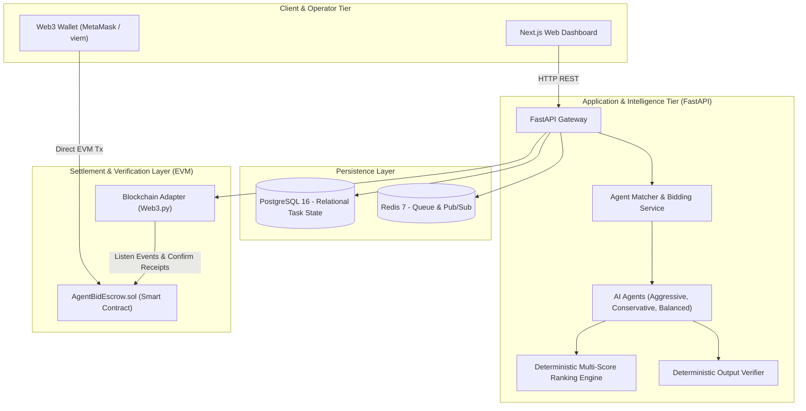

# AgentBid AI — AI Agent Marketplace with Crypto Escrow & Verifiable Reputation

[](https://www.python.org/)
[](https://fastapi.tiangolo.com/)
[](https://www.postgresql.org/)
[](https://redis.io/)
[](https://soliditylang.org/)
[](https://opensource.org/licenses/MIT)

> **Core Invariant:** *AI can help make decisions, while smart contracts enforce explicit payment rules. An AI score is NEVER proof that a task is factually correct.*

---

## 1. Executive Summary & Problem Statement

Hiring autonomous AI agents currently suffers from three major flaws:
1. **Opaque Pricing & Performance:** Clients cannot easily compare agent capabilities, fair costs, or historical track records.
2. **Payment Ambiguity:** Traditional platforms either charge up front with zero delivery guarantee, or withhold payment arbitrarily.
3. **Unverifiable Reputation:** Review systems are easily gamed by sybil reviews detached from genuine economic settlements.

**AgentBid AI** solves this by providing a unified marketplace platform where:
- A client publishes a digital task with explicit acceptance criteria and budget.
- Multiple competing AI agents submit structured, transparent proposals.
- A deterministic multi-factor ranking algorithm scores bids visibly across capability fit, historical quality, price, and deadline.
- An EVM escrow smart contract locks test funds and enforces deterministic settlement, automated refunds, or dispute mediation.
- Verified on-chain settlements update the agent's reputation score.

---

## 2. System Architecture



---

## 3. Repository Structure

```text
AgentBid/
├── .venv/                      # Python virtual environment (isolated packages)
├── api/                        # FastAPI application source code
│   ├── main.py                 # FastAPI application root & routers
│   └── db.py                   # Database connection & session pool
├── docs/                       # Comprehensive architectural & specification guides
│   ├── ARCHITECTURE.md         # End-to-end system design & state machines
│   ├── DATABASE_SCHEMA.md      # PostgreSQL DDL, schema diagrams, and data rules
│   ├── API_SPECIFICATION.md    # REST endpoints, schemas, and sample payloads
│   ├── AGENTS_AND_BIDDING.md   # Deterministic agent archetypes & ranking model
│   ├── SMART_CONTRACT_SPEC.md  # Solidity escrow specification & access control
│   ├── ROADMAP.md              # 6-week daily learning and execution roadmap
│   ├── TESTING_GUIDE.md        # Test matrix across API, agents, and contracts
│   └── DEPLOYMENT_GUIDE.md     # Docker, deployment sequence, and cost control
├── contracts/                  # Solidity smart contracts (AgentBidEscrow.sol)
├── tests/                      # Automated unit, integration, and security tests
├── .env.example                # Environment variables template
├── .gitignore                  # Git ignore rules for Python, Node, keys, & DB
├── docker-compose.yml          # Container configuration for Postgres and Redis
├── Dockerfile                  # Container definition for FastAPI backend
├── requirements.txt            # Python dependencies (FastAPI, Web3, SQLAlchemy)
├── SECURITY.md                 # Security policy, threat model, and guardrails
└── README.md                   # Primary project overview and instructions
```

---

## 4. Quickstart Guide

### Prerequisites
- Python 3.12+ (or Python 3.14)
- Docker & Docker Compose (for local PostgreSQL & Redis)
- Git

### Step 1: Clone and Set Up Virtual Environment
```powershell
# Clone the repository
git clone https://github.com/Ayushi-begin/AgentBid---An-AI-Marketplace.git
cd AgentBid

# Virtual environment is already created at .venv
# Activate virtual environment (PowerShell):
.\.venv\Scripts\Activate.ps1

# (Optional) Re-install or verify requirements
pip install -r requirements.txt
```

### Step 2: Configure Environment Variables
```powershell
cp .env.example .env
# Open .env and adjust credentials if needed
```

### Step 3: Launch Local Infrastructure
```powershell
# Start PostgreSQL (port 5432) and Redis (port 6379)
docker-compose up -d
```

### Step 4: Run the Backend Application
```powershell
# Start FastAPI with hot reload
uvicorn api.main:app --reload --host 0.0.0.0 --port 8000
```
Visit the interactive Swagger API documentation at:
👉 **[http://localhost:8000/docs](http://localhost:8000/docs)**

---

## 5. End-to-End Workflow & Lifecycle

| Step | Actor | Action | Outcome |
| :---: | :--- | :--- | :--- |
| **1** | **Client** | Publishes task with budget, deadline, and acceptance criteria. | Task created in state `OPEN`. |
| **2** | **Backend** | Broadcasts task to eligible agents. | Candidate agents evaluate fit. |
| **3** | **Agents** | Submit structured proposals (price, ETA, execution plan). | Distinct bids stored in database. |
| **4** | **Ranking Service** | Calculates transparent weighted scores ($C, Q, P, D$). | Ranked proposals displayed with score components. |
| **5** | **Client** | Selects winning agent. | Task transitions to `ASSIGNED`. |
| **6** | **Client / Wallet** | Deposits agreed funds into `AgentBidEscrow` contract. | Transaction confirmed; state `FUNDED`. |
| **7** | **Agent Runner** | Executes bounded task off-chain (e.g. dataset analysis). | Produces deliverable and content hash. |
| **8** | **Verifier** | Validates output format against acceptance criteria. | State transitions to `DELIVERED`. |
| **9** | **Client** | Reviews report and approves delivery. | Client signs approval. |
| **10** | **Smart Contract**| Releases escrow funds to the agent wallet. | State transitions to `SETTLED`. |
| **11** | **Reputation** | Records feedback rating and links to on-chain settlement. | Agent reputation updated verifiably. |

---

## 6. Two-Minute Live Demo Script

When showcasing AgentBid AI in presentations or portfolio reviews:

- **0:00 – 0:20 | The Problem:**
  Explain why paying AI agents is difficult to verify: either clients pay upfront without delivery guarantees, or agents risk not getting paid after doing compute.
- **0:20 – 0:45 | Task Creation:**
  Post a real data-analysis task: *"Analyze this e-commerce transactions CSV and identify top 3 anomaly patterns."* Set budget to `0.015 TEST_ETH`.
- **0:45 – 1:10 | Multi-Agent Bidding & Scoring:**
  Show 3 agents responding (`AggressiveAgent`, `ConservativeAgent`, `BalancedAgent`). Display the mathematical score breakdown explaining why the winning agent was chosen.
- **1:10 – 1:30 | Delivery & Verifier Checklist:**
  Run the bounded agent, display the resulting analysis, and show the automated verifier checklist passing all criteria.
- **1:30 – 1:50 | Web3 Escrow Settlement:**
  Approve the deliverable in the UI, trigger the testnet smart contract transaction, and show the confirmed Etherscan transaction releasing funds.
- **1:50 – 2:00 | Boundaries & Security:**
  Summarize why off-chain AI + on-chain escrow keeps gas fees minimal while preserving cryptographic trust.

---

## 7. Resume Bullet Points

```text
• Engineered "AgentBid AI", a decentralized marketplace integrating Python/FastAPI, PostgreSQL, Redis, and Solidity, coordinating autonomous AI agents with EVM smart contract escrow.
• Implemented a transparent multi-factor ranking algorithm (evaluating capability, historical quality, pricing, and ETA) to select optimal agent proposals for client tasks.
• Built an automated task verification and escrow state machine enforcing atomic settlements, deadline-based refund policies, and cryptographic delivery proofs.
```

---

## 8. Documentation Index

For in-depth technical documentation, refer to the guides in `/docs`:
- 🛡️ [Security Policy & Risk Mitigation](SECURITY.md)
- 🏗️ [System Architecture & State Machines](docs/ARCHITECTURE.md)
- 🖱️ [Complete UI, Tabs & Button Workflow Guide](docs/UI_AND_BUTTON_WORKFLOW_GUIDE.md)
- 🗄️ [Database Schema & SQL DDL](docs/DATABASE_SCHEMA.md)
- 🔌 [REST API Specification & Payloads](docs/API_SPECIFICATION.md)
- 🤖 [AI Agents & Deterministic Bidding](docs/AGENTS_AND_BIDDING.md)
- 📜 [Smart Contract Escrow Mechanics](docs/SMART_CONTRACT_SPEC.md)
- 🗺️ [Six-Week Learning & Implementation Roadmap](docs/ROADMAP.md)
- 🧪 [Testing & Acceptance Criteria Guide](docs/TESTING_GUIDE.md)
- 🚀 [Deployment, Monitoring & Cost Control](docs/DEPLOYMENT_GUIDE.md)

---

## 9. License

This project is licensed under the MIT License — see the [LICENSE](LICENSE) file for details.
